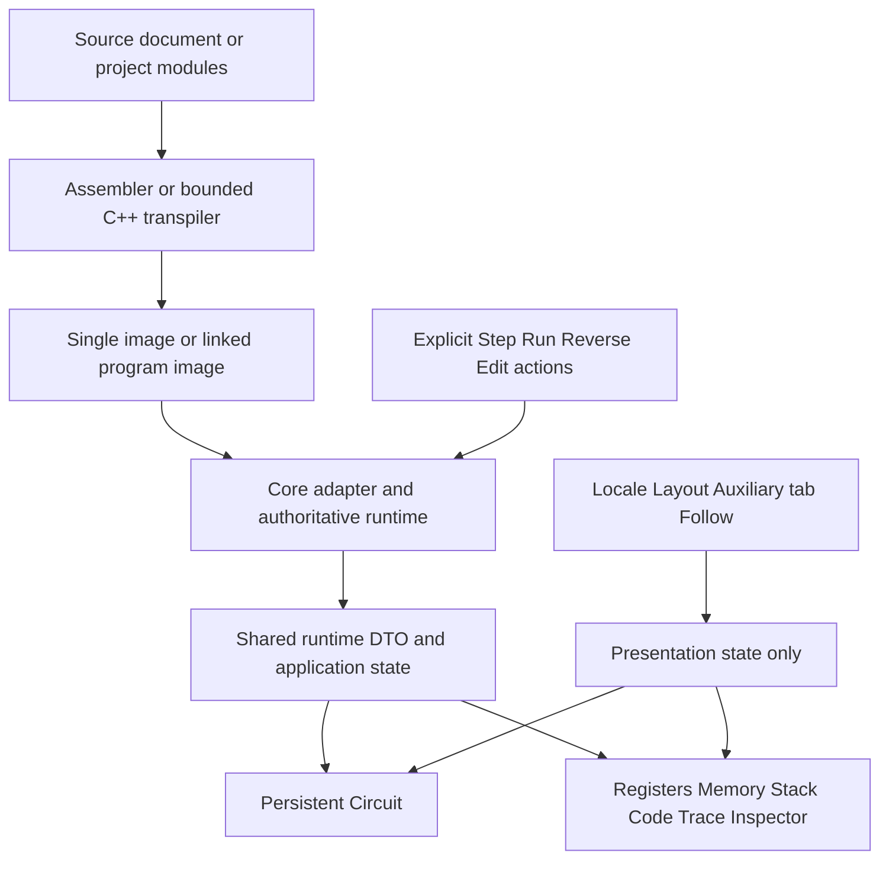

# 前端技术交接

- Audience: Claude、前端开发者与审查者
- Status: Handover snapshot
- Last reviewed version: 0.1.0
- Classification: Handover snapshot
- Related: [入口](README.md), [需求](requirements-and-acceptance.md), [架构总览](../developer/architecture-overview.md)

## 技术栈与边界

当前项目使用 React 18、TypeScript、Vite、Monaco Editor、lucide-react、Vitest 和 Playwright。精确依赖以 [package.json](../../package.json) 和 lockfile 为准。Node 范围为 `>=20 <25`，package manager 固定 `pnpm@11.7.0`。

Web 是静态站点；production 使用 WASM Core。Tauri 复用同一前端与 WASM，不是第二套模拟器。Mock 用于开发与测试，不能用 Mock 的成功替代 WASM/Core 验证。C++ Core 是运行时权威，不执行用户提交的 native C++。

图中的 presentation state 不能反向计算 CPU 状态。观察组件从真实 DTO 渲染；只有显式执行、调试器修改等受控 action 才能操作 runtime。

## 实际文件地图

路径相对应用仓库根。概念上的 `ObservationWorkspace` 不是一个现成的同名文件。

| 文件或目录 | 负责什么 | 前端交接注意 |
| --- | --- | --- |
| [src/main.tsx](../../src/main.tsx) | 启动、Monaco 配置、样式入口 | 不重做初始化与资源装载 |
| [src/App.tsx](../../src/App.tsx) | 应用组合、文档与 project lifecycle | 不是纯布局文件，不能整体覆盖 |
| [useAppStore.tsx](../../src/store/useAppStore.tsx) | React state、actions、运行时状态发布 | 不引入第二套状态权威 |
| [applicationRuntime.ts](../../src/runtime/applicationRuntime.ts) | 应用运行时组合 | 不是样式优化范围 |
| [CircuitFocusLayout.tsx](../../src/components/CircuitFocusLayout.tsx) | workspace header、多种辅助观察子面板、布局 | 优先理解已有内部组件再小范围改动 |
| [CaslCompatibilityMode.tsx](../../src/components/CaslCompatibilityMode.tsx) | CASL 工作区与相应控制 | 与 COMET 布局共用部分逻辑，需双模式回归 |
| [PersistentCircuitPane.tsx](../../src/components/PersistentCircuitPane.tsx) | 持续存在的 live Circuit 容器 | 不在每个 tab 复制一份 |
| [CometCircuitSvg.tsx](../../src/visual/CometCircuitSvg.tsx) | 电路渲染 | SVG 是数据路径，不是可以随意改语义的插图 |
| [workspace.ts](../../src/observation/workspace.ts) | 稳定 tab/layout identity 与旧模式映射 | 不用翻译文本作为 key |
| [CometMicrocyclePanel.tsx](../../src/components/CometMicrocyclePanel.tsx) | 微周期状态、执行与反向控件 | 保留 availability 和 blocked reason |
| [ReverseInstructionControl.tsx](../../src/components/ReverseInstructionControl.tsx) | 指令级回退控件 | 不在组件内实现 inverse |
| [SourceEditor.tsx](../../src/components/SourceEditor.tsx) | Monaco、源码、markers | 保留 source ownership 与诊断 range |
| [Toolbar.tsx](../../src/components/Toolbar.tsx) | 全局命令 | 不继续堆砌观察控件 |
| [RegisterPanel.tsx](../../src/components/RegisterPanel.tsx)、[MemoryPanel.tsx](../../src/components/MemoryPanel.tsx) | 通用数据视图 | 同时检查 workspace 内部 Focus 子面板，不漏改 |
| [TracePanel.tsx](../../src/components/TracePanel.tsx)、[SourceMapPanel.tsx](../../src/components/SourceMapPanel.tsx) | 执行记录与映射 | 不是另一个 source/parser |
| [InspectorPanel.tsx](../../src/components/InspectorPanel.tsx)、[DoubleValueInspector.tsx](../../src/components/DoubleValueInspector.tsx) | Inspector 与 binary64 解码显示 | 当前值从 VM memory 取，不从 literal 重算 |
| [OutputPanel.tsx](../../src/components/OutputPanel.tsx)、[StatusBar.tsx](../../src/components/StatusBar.tsx) | 输出、诊断、状态 | 失败、waiting input 等状态不能仅用颜色 |
| [ProjectModulesPanel.tsx](../../src/components/ProjectModulesPanel.tsx) | 模块操作与链接入口 | 编辑器当前 tab 不等于执行中的模块 |
| [src/styles](../../src/styles) | tokens.css、app.css | 优先复用 tokens，审查断点与滚动容器 |
| [src/i18n](../../src/i18n) | EN / JA / zh-CN 字符串与类型 | 三语言一起维护，不拼完整句 |

## 不应混入前端美化的模块

- [src/core](../../src/core)：adapter、bridge、DTO、Mock/WASM 实现；[cpp-core](../../cpp-core)：机器执行权威。
- [src/transpiler](../../src/transpiler)：C++ teaching subset、AST、lowering、double storage metadata。
- [src/linker](../../src/linker)：独立 module assembly、symbol/relocation、linked image ownership。
- [src/documents](../../src/documents)：source identity、Dirty、保存、异步文件操作所有权。
- [src/preferences](../../src/preferences)：现有 preference 契约；其他独立存储见 [storage reference](../reference/storage-keys.md)。
- [src/visual](../../src/visual) 的 path resolver 与 state：只有确认数据路径语义不变时才做展示层调整。
- [src-tauri](../../src-tauri)：壳、能力配置与构建。不能为 UI 新增 shell/process/native file 扩权。

## 必须保持的数据契约

**COMET II**：16-bit words、GR0–GR7、PR、SP；FR 只有 OF/SF/ZF。没有 CF、FPU、64-bit bus、cache 或 pipeline。不要把未来 x86 的 CF 搬进 COMET。

**指令与微周期**：CASL Mode 的 Step 完成一条机器指令，COMET Mode 的 Step 推进真实 microcycle。Macro 先展开为机器指令。可视化来自执行状态，不播放根据源码推演的动画。

**反向执行**：Reverse Microstep 仅 COMET 可用；Reverse Instruction 在 CASL/COMET 可用，原子回退当前完整或部分机器指令到 Fetch 前。最多 1000 条 history；不跨 mutation、SVC/I/O、Reset、Reload、Full Clear、source/assembly/backend/link ownership 边界。不能删除输出或重放源码来伪装回退。Trace 表示当前时间线，不加入虚假的 reverse execution 行。

**异步所有权**：保留 sourceUnitId、assembly/link identity、executionEpoch、historyEpoch、timelineRevision 的既有校验。tab、locale、数字格式和布局不是 barrier；不能让 stale completion 覆盖新状态。

**文件**：New/Open/Save/Save As 与 Dirty guard 保持现有实现；UTF-8 与 1 MiB 限制、download fallback 的成功语义不能美化成未发生的文件保存。不将文件内容、路径或 handles 放入 preference。

**持久化**：只使用既有 locale、UI preferences、last built-in example、lesson progress 四类存储。具体 key 以 [storage-keys.md](../reference/storage-keys.md) 为准。不新增 source、VM、诊断、history、project 的持久化。

**多模块**：模块独立 assemble，再通过 relocation 链接；不能拼接源码。CALL/RET、Trace、Machine Code、Source Mapping 与 Reverse 使用 linked image 的真实 module ownership。切 editor tab 不应改变当前执行模块身份；relink 和模块变更保留 history barriers。

**double**：binary64 high-word-first、4 个连续 16-bit words，只支持已实现的 local storage/literal/copy 观察；不是完整 C++，没有 double arithmetic、comparison/conversion 或 native FPU。

**诊断**：不能改已有 code identity、producer、range、severity/order。locale 改变只更新显示；不重新 parse，不暴露 raw exception 作为主消息。

## 关键契约与测试入口

先读 [Observation linking](../observation-data-linking-contract.md)、[workspace layout](../developer/observation-workspace-layout.md)、[clean-wire contract](../comet-microcycle-visual-contract.md)、[reverse integrity](../reverse-history-integrity.md)、[document lifecycle](../developer/document-lifecycle.md)、[persistence](../developer/persistence-architecture.md)。

直接相关测试：[workspace](../../src/tests/phase20e1UnifiedObservationWorkspace.test.tsx)、[Reverse Instruction](../../src/tests/phase20eReverseInstruction.test.tsx)、[Reverse Microstep](../../src/tests/phase20dReverseMicrostep.test.tsx)、[microcycle UI](../../src/tests/phase20cMicrocycleUi.test.tsx)、[double UI](../../src/tests/cppDoubleUi.test.tsx)、[WASM adapter](../../src/tests/wasmCoreAdapter.test.ts)、[E2E](../../tests/e2e)。

不要用新一套静态数据 UI 替换上述行为，也不要仅因外观相似就宣称 parity。
